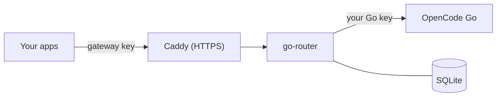

# Go Router: OpenRouter-compatible gateway for OpenCode Go

Go Router lets your applications use an **OpenCode Go** subscription through the
**OpenRouter API**. Apps switch by changing three values:

```text
Base URL: https://your-domain/api/v1
API key:  a gateway key created in the dashboard (sk-gr-...)
Model:    deepseek/deepseek-v4.1-flash   (any ID from /api/v1/models)
```

It is one small Rust program with a built-in SQLite database and admin dashboard.
The models run at OpenCode, so the server needs no GPU: in a 50-user load test
the gateway used about 30 MiB of RAM and 9% of one CPU core.



## Features

- **OpenRouter-compatible API:** chat completions (JSON and streaming), tools,
  structured output, reasoning, images, audio and PDF input, model fallbacks, plus
  native Responses and Anthropic Messages endpoints. Works with the OpenAI and
  OpenRouter SDKs.
- **Separate keys per app:** each with its own expiry, rate limit, allowed models and
  spending caps per hour, day and month. Your OpenCode Go key never leaves the server.
- **Dashboard:** keys with per-key statistics (spend, requests, tokens, latency, daily
  and hourly charts, per-model breakdown), request logs, cash cost vs. Go allowance per
  request, model catalog, admin audit log and a live **Server monitor** (CPU, memory, latency).
- **Secure defaults:** HTTPS through Caddy, gateway on `127.0.0.1` only, hashed keys,
  Argon2 admin password, CSRF and origin checks, strict CSP.

Not included: OpenRouter's non-Go models, credits and payments, embeddings, image
generation, file storage and other hosted platform features. These return `501`.
See the [compatibility matrix](docs/compatibility.md).

## Set up a server

| Server | Guide | Time |
|---|---|---|
| **Windows Server 2019+** | [docs/setup-windows.md](docs/setup-windows.md): Git, then one install script | ~15 min |
| **Ubuntu 22.04+ / Debian 12+** | [docs/setup-linux.md](docs/setup-linux.md): release binary, systemd, Caddy (or Docker) | ~15 min |

You need a domain with a DNS A record pointing to the server, inbound TCP 443
(and usually 80) open, and an OpenCode Go API key. Nothing is compiled on the server.

After installing: sign in at `https://your-domain/admin`, save the Go key in
**Setup & settings**, and create one **API key** per application.

## Use it from an application

```python
import os
from openai import OpenAI

client = OpenAI(
    base_url="https://your-domain/api/v1",
    api_key=os.environ["GATEWAY_API_KEY"],   # a gateway key, never the Go key
)
reply = client.chat.completions.create(
    model="deepseek/deepseek-v4.1-flash",
    messages=[{"role": "user", "content": "Hello"}],
)
print(reply.choices[0].message.content)
```

```bash
curl https://your-domain/api/v1/chat/completions \
  -H "Authorization: Bearer $GATEWAY_API_KEY" \
  -H "Content-Type: application/json" \
  -d '{"model":"deepseek/deepseek-v4.1-flash","messages":[{"role":"user","content":"Hello"}],"stream":true}'
```

Send the full conversation in `messages` on every request; the gateway does not
store chat history. An optional `x-opencode-session` header with a stable ID per
conversation improves upstream caching. More in the [API guide](docs/api.md) and
[examples](examples/).

## Costs

Every answer includes OpenCode's receipt in `usage`:

- `cost`: extra cash actually charged (usually `$0` on the Go plan).
- `opencode.allowance`: how much of the Go plan's limit the request used.
- `opencode.list_cost`: the list-price value, for comparison only.

All gateway keys share one Go subscription and its limits. OpenCode describes Go as
intended for coding agents and monitors traffic; check its
[terms](https://opencode.ai/docs/go/) before serving other workloads.

## Documentation

| Document | Contents |
|---|---|
| [How it works](docs/how-it-works.md) | Architecture, request flow, source code map, data on disk |
| [Windows setup](docs/setup-windows.md) / [Linux setup](docs/setup-linux.md) | New server from scratch |
| [Operations](docs/operations.md) | Logs, monitoring, updates, backups, limits, troubleshooting |
| [API](docs/api.md) / [Compatibility](docs/compatibility.md) | Endpoints, parameters, differences from OpenRouter |
| [Testing](docs/testing.md) | Test suites, load test and measured results |
| [Security](SECURITY.md) | Security model and reporting |
| [.env.example](.env.example) | Every setting, explained |

## Development

Requires Rust 1.88+ and a C compiler (for bundled SQLite).

```bash
cargo fmt --all -- --check
cargo clippy --locked --all-targets -- -D warnings
cargo test --locked
cargo build --locked
python3 tests/integration.py      # full gateway against a mock model; no credentials
python3 scripts/check_catalog.py
```

To run locally: `python3 scripts/setup.py`, then `cargo run`, then open
`http://localhost:8080/admin` (password in `data/admin-login.txt`).

Releases: pushing a `v*` tag builds Windows and Linux (x86_64, ARM64) packages with
checksums through GitHub Actions. Install scripts download the latest release.

MIT licensed. Go Router is an independent project, not affiliated with OpenRouter or OpenCode.
