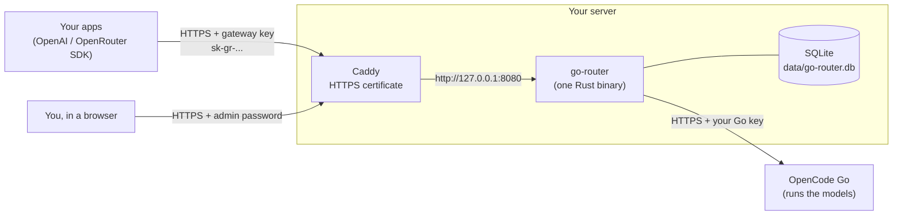

# How Go Router works

Go Router lets your applications use an **OpenCode Go** subscription through the
same API they would use for **OpenRouter**. Applications change only the base
URL, the API key and the model name.

- **The models run at OpenCode, not on your server.** The server only passes
  requests and answers through, so it needs no GPU and very little memory
  (about 30 MiB under a 50-user load test).
- **Caddy** is the only program that is reachable from the internet. It gets and
  renews a free Let's Encrypt certificate and forwards traffic to the gateway,
  which listens on `127.0.0.1` only.
- **Your OpenCode Go key never leaves the server.** Each application gets its own
  gateway key, which you can limit, expire or revoke without touching the others.

## What happens on one request

1. An app sends `POST /api/v1/chat/completions` with `Authorization: Bearer sk-gr-...`.
2. The gateway hashes the key and looks it up. Unknown, revoked or expired keys
   get `401`. The key's requests-per-minute limit and allowed models are checked.
3. The request body is read (up to `MAX_BODY_BYTES`) and the model name is
   translated, for example `deepseek/deepseek-v4.1-flash` becomes Go's `deepseek-v4.1-flash`.
4. If all `MAX_CONCURRENT_REQUESTS` slots are busy, the app gets `429` and should retry.
5. The request goes to OpenCode Go with the server's Go key. If the model fails
   before answering and the request listed fallback `models`, the next one is tried.
6. The answer is returned in OpenRouter's format. Streams are passed through as they
   arrive, with keep-alive comments and a final usage chunk.
7. The request, its token usage and its cost are saved for the dashboard. Apps can
   look up their own requests with `GET /api/v1/generation?id=...`.

The gateway never runs tools, commands or code from a model's answer. Tool calls
are returned to the app that asked for them, exactly like OpenRouter.

## Costs shown in the dashboard

OpenCode returns a receipt with every answer. The gateway keeps its three numbers
separate:

| Field | Meaning |
|---|---|
| `cost` | Extra cash actually charged. Usually `$0` on the Go plan. |
| `allowance` | How much of the Go plan's monthly limit the request used. |
| `list_cost` | What the request would cost at list price, for comparison. |

All gateway keys share one Go subscription. More keys do not mean more allowance.

## Source code map

| Path | What it does |
|---|---|
| `src/main.rs` | Starts the server, background cleanup and the metrics sampler. `--check`, `--healthcheck`, `--version` flags. |
| `src/lib.rs` | Shared application state and the list of HTTP routes. |
| `src/config.rs` | Reads `.env` / environment variables and validates them. |
| `src/auth.rs` | Gateway key checks, rate limits, admin session, CSRF and origin checks. |
| `src/proxy.rs` | Inference endpoints: validation, model selection, fallbacks, upstream calls. |
| `src/sse.rs` | Streaming parser that rewrites model names and extracts usage. |
| `src/api.rs` | Public metadata endpoints: models, providers, key info, generation lookup. |
| `src/admin.rs` | Dashboard API: login, keys, logs, settings, Go key, metrics. |
| `src/audit.rs` | Middleware that records each request for logs, usage totals and metrics. |
| `src/db.rs` | SQLite storage on one worker thread (keys, logs, daily usage, sessions). |
| `src/metrics.rs` | CPU, memory and latency samples for the **Server monitor** tab. |
| `src/models.rs` | Loads and serves the model catalog in `config/models.json`. |
| `src/error.rs` | OpenRouter-style error responses. |
| `static/` | The dashboard (HTML, CSS, JS), embedded into the binary at build time. |
| `config/models.json` | The reviewed list of Go models, aliases, limits and list prices. |
| `scripts/` | Setup, update and domain helpers for Windows and Linux. |
| `deploy/` | Caddy and systemd files for Linux and Docker. |
| `tests/` | Integration, contract, browser and load tests (no real model calls except `loadtest.py` without `--mock`). |

## Data on disk

Everything private lives in `.env` and the `data/` folder. Neither is in Git.

| File | Contents |
|---|---|
| `.env` | Settings and the admin password. |
| `data/go-router.db` (+ `-wal`, `-shm`) | Saved Go key, gateway key hashes, request logs, daily usage, admin sessions and events. |
| `data/admin-login.txt` | The generated dashboard URL and password. |
| `data/server.log` (Windows) | Gateway output, including a `perf` line every minute while busy. |
| `data/caddy/` (Windows) | Caddy's certificates and log. |

Gateway keys and admin sessions are stored only as SHA-256 hashes. The admin
password is checked with Argon2. The Go key must be sent to OpenCode, so it is
stored as-is in the database: protect the `data/` folder and its backups.
